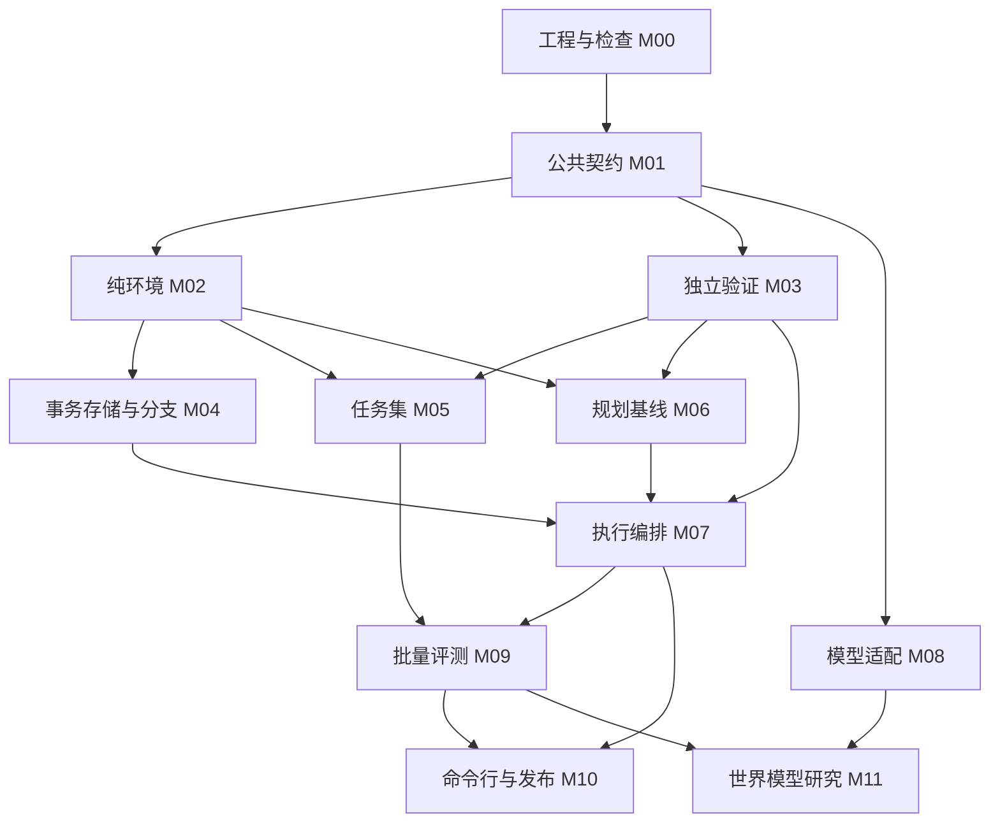

# AI 程序世界实验平台：多模型制作计划 v1.0

> 执行者按模块任务卡逐项完成；可使用 `executing-plans` 工作流。每个模块先验证公共契约和失败案例，再实现并交接。多模型的分配与合并由一个集成人负责。

**Goal：** 建立可验证、可回放、可替换候选生成模型的四寄存器程序实验平台，并为独立的世界模型研究预留接口。

**Architecture：** Python 模块化单体；模块通过公共类型和 Protocol 通信，SQLite 保存真实执行与预算，验证器独立检查事实。先做确定性环境与离线基线，再接两个真实模型后端，学习预测与规划作为后续研究阶段。

**Tech Stack：** Python 3.14、标准库、SQLite；开发依赖 pytest、jsonschema、mypy。首期无需 GPU，机器学习依赖另建环境。

日期：2026-10-11，Asia/Shanghai。状态：制作与接口规格，尚未实现平台或验证模型收益。

## 1. 阅读与派发顺序

| 文件 | 用途 | 谁必须阅读 |
|---|---|---|
| `00-README.md` | 范围、依赖图、阶段门槛 | 所有执行模型 |
| `01-contract.md` | 状态、动作、错误、预算、持久化语义 | 所有执行模型 |
| `02-integration.md` | 文件所有权、分支、接口变更与合并 | 所有执行模型 |
| `03-modules/M00.md` 至 `M11.md` | 每个模块的任务与验收 | 对应执行模型、集成人 |
| `04-handoff-prompts.md` | 可以直接派发的任务与交接模板 | 用户、集成人 |
| `05-research-roadmap.md` | 世界模型实验和真实代码扩展条件 | 研究模型、用户 |
| `06-acceptance.md` | 验收案例、组合测试、阶段证据 | 测试模型、集成人 |
| `07-plan-verification.md` | 计划包本身的实测校验记录 | 所有执行模型 |
| `tools/verify_plan.py` | 可重复运行的计划一致性检查 | 集成人 |
| `contracts/v1/schema.json` | JSON Schema 的统一数据定义 | M01、全部数据生产与消费模块 |
| `contracts/v1/types.pyi` | 公共 Python 类型参考 | 全部模块 |
| `contracts/v1/ports.pyi` | 公共方法签名参考 | 全部模块 |
| `contracts/v1/golden.json` | 固定输入与人工可核算的输出 | 全部模块 |
| `module-manifest.json` | 模块依赖、所有权、门槛的机器清单 | 集成人、自动检查 |

这份目录是交付计划包，不是应用源码。首次开发由 M00/M01 在实际仓库建立对应目录；计划包里的 `.pyi` 是接口规格，不能用来冒充已实现的运行模块。

## 2. 锁定范围

第一版面向本机单用户研究与学习：四个寄存器、四种有限动作、内部状态快照、分支、可回放日志、独立验收、离线基线、命令行演示。

第二个工程阶段加入可替换的模型适配器。第一家真实后端完成后，再用不同协议的第二家后端验证抽象，分别报告协议正确性与解题结果。

研究阶段在同一平台中比较学习型下一状态预测和规划。它与 LeCun 所强调的表示、预测与规划方向相容；寄存器快照本身不是世界模型，离散状态监督预测也不自动构成 JEPA。

实际开发根目录示例为 `D:\AIProgramWorldLab`，执行者按本机环境确定实际路径。M00 必须先检查该目录是否已存在；若有无关内容，选择新的目录并记录实际路径，不能覆盖。本仓库的计划包位于 `docs/plan-v1/`，发布计划不创建应用目录。

## 3. 选定架构与理由

| 方案 | 优点 | 主要代价 | 选择 |
|---|---|---|---|
| 模块化单体、进程内 Protocol、SQLite | 易调试、事务边界明确、离线可测试、适合多个模型分工 | 需要严格维护依赖和文件所有权 | 采用 |
| 多服务、HTTP/RPC、独立数据库 | 跨语言与远端扩展更直接 | 过早引入部署、分布式事务和接口重复定义 | 出现远端执行需求再评估 |
| 裸机/Rust/自定义系统 | 可深入研究底层能力 | 驱动、生态、推理兼容和验证成本很大 | 当前阶段不安排 |

## 4. 模块图

图中是合并所需的依赖。M08 可早期用假响应独立制作；它的真实调用实验在离线平台通过验收后启动。M07 通过 `DecisionPort` 使用 M06 或 M08，不在源码中导入它们的具体实现。

运行时依赖固定为：M02 产出真实转移；M04 在事务中调用 M02 并记录事实；M07 调用 M04，随后调用 M03 判定目标。M06/M08 只提候选。M09 读取事实与计量器结果。M11 只预测，不写执行记录。

## 5. 分阶段制作

| 阶段 | 工作与可并行安排 | 退出门槛 | 可演示结果 |
|---|---|---|---|
| P0 契约底座 | M00，然后 M01；由一人维护共享文件 | G0 | 所有模型拿到同一接口、样例和基准提交 |
| P1 执行基础 | M02 与 M03 并行；M04 使用假 Runtime 开始，等 M02 后合并 | G1 | 动作、快照、分支、重试、恢复的事实记录 |
| P2 离线闭环 | M05、M06 并行；M07 接入；随后 M09、M10 | G2 | 30 个冒烟任务和冻结 100 个开发任务可重复运行 |
| P3 模型兼容 | M08 假响应测试；真实 A 后端，随后不同协议的 B 后端 | G3 | 同一命令行配置切换后端，无须修改执行层 |
| P4 世界模型研究 | M11，保持 P2/P3 基线可运行 | G4 | 单步、多步、拒绝预测、规划净收益实验 |
| P5 真实代码试点 | 新设计与契约大版本，参见研究路线 | 新门槛 | 在验证隔离之后处理单文件修改与固定测试 |

G0：Schema、Python 类型、端口、样例对应；依赖图无环；公共目录有唯一负责人。

G1：固定转移、独立审核、事务去重、状态冲突、分支隔离、预算不回退和重启测试通过。

G2：离线 CLI 可完成完整闭环；100 个任务结果可追溯；相同配置事实轨迹一致，时间与新生成 ID 不要求逐字相同。

G3：两家协议不同的真实后端各保留至少 10 个有效调用证据；超时、限流、错误格式、用量未知由假响应测试覆盖。无法访问第二家时记录 G3 尚未完成，不用模拟测试替代真实兼容证明。

G4：冻结数据与对照预算，报告完整单步状态准确率、多步误差与规划成本。工程可运行即可交付实验；研究增益可以为负，不把收益未知写成完成。

## 6. 最多三个执行模型加一个集成人

用户可以自行换模型品牌，岗位比品牌重要。集成人维护 M00/M01、公共冻结版本、组合测试、合并顺序与交付证据。另一个模型写执行层，一个写独立验证/评测，一个写候选生成/适配/研究。

同一时期并发任务通常控制在 2 至 3 个。M02 和 M03 应分开上下文，验证模型先依据规格与人工样例写检查规则，再读取执行实现，降低复制同一错误的风险。审查人不直接修改公共契约。

工作波次：

1. 集成人完成 M00/M01，提交并宣布冻结基准。
2. 分派 M02、M03、M08 的离线适配部分，各自独立分支。
3. 合并 M02/M03 后分派 M04、M05、M06。
4. M04/M06 完成后 M07；M09/M10 可先按假对象制作，实际合并等依赖就绪。
5. G2 后完成 M08 真实后端，进行 G3。
6. G3 通过或明确记录外部访问阻塞后，再启动 M11；研究并不需要所有 LLM 品牌都接入。

## 7. 什么能保证，什么须用证据确认

固定接口、文件所有权、契约测试和组合验收可以显著减少多模型各写一套的情况。任何计划都不能提前保证全部代码兼容；只有在同一冻结提交上集成、运行并保存结果，才能确认某个版本已对接。

模块有四种状态：`not_started`、`in_progress`、`review_ready`、`accepted`。`review_ready` 需要提交、测试和交接材料；`accepted` 需要集成人在组合仓库上复测。设计稿、测试代码、模拟后端通过、真实调用成功、研究收益成立分别记录，不混为一个“已完成”。

## 8. 时间、费用与学习安排

这份计划按门槛推进，不承诺固定成功率和交付日期。执行前三个模块后，用实测的制作、纠错与合并时间更新排期；模型并发数不等于速度倍数。

工作量权重见模块清单，权重 1/2/3/5 分别表示相对规模，不代表小时。每次派发安排一个有明确验收的任务，开发者可把任务拆成“写一个失败案例、运行、实现、再运行、提交”的短步骤。

P0 至 P2 可离线制作。依赖安装的网络流量较小，运行本身无需 API 或大型模型。P3 的云端调用金额由用户已配置的后端、输入输出和重试决定；调用前显式配置预算，无法可靠估价时仅允许受限冒烟测试，不承诺费用。P4 先用 CPU 简单基线，机器学习依赖与显存适配单独验证。

用户每个门槛亲自核对一个例子：动作方向、快照恢复、重复请求、目标保持约束、预测错误。无需承担每行代码审查，但必须能判断演示是否符合目标。

## 9. 首次派发

先派 M00，再派 M01。不要把全部文件同时交给多个模型自由修改。派发时使用 `04-handoff-prompts.md` 的模板，并附上计划包、实际仓库根目录、冻结提交、契约摘要和该模块任务卡。

新计划在实施顺序和接口上优先于早期长期计划；早期调研仍可作为背景，不作为 v1.0 接口依据。若实际代码与计划冲突，提出变更单并检查消费者后再修改。
